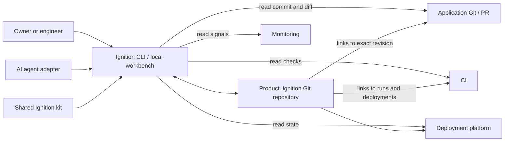

# Ignition product design

**Status:** Proposed for owner review
**Scope:** Product-independent engineering workspace
**Version:** Design draft 0.1, 27 October 2026

## Product promise

Ignition helps a product owner and engineering agents answer five questions at any time: What are we building? Why this design? What changed? What evidence shows it works? What is running and how do we recover?

It should make disciplined engineering easier to follow, without becoming a second application codebase or another place to paste every conversation. A record is useful only when it points to a real decision, revision, observation, or owner.

## Boundaries

- The shared Ignition repository contains the workflow and templates; schemas and validators are planned for the first usable version.
- Each product has a separate, private `.ignition/` Git checkout for its work items, decisions, analysis, evidence, releases, incidents, and agent context. The application Git repository ignores it.
- Application code, tests, migrations, and runtime configuration stay in the application repository. Git/PRs, CI, deployment platforms, and monitoring retain their own authoritative events. Ignition stores links and durable conclusions, not copies of every log.
- Secrets and raw personal or production data never enter `.ignition/`. Restricted evidence is referenced through an access-controlled store with a retention rule.

Ignition will not initially replace a tracker, CI service, deployment platform, observability system, or code editor. It will not infer that a passing unit test proves a production journey or deploy on an agent's assertion.

## Record model

Every record has a stable ID, type, status, owner, product, timestamps, links, and a Markdown body. The machine-readable header makes validation and a future UI possible. The body holds rationale and human explanation.

| Type | Key relationships | Distinctive fields |
| --- | --- | --- |
| Work item | Design, PR, evidence, release | Kind, size, risk, urgency, outcome, acceptance criteria, initial blast radius |
| Design/decision | Work item, superseding decision | Options, chosen approach, reason, data/security impact |
| Evidence | Work item, commit, CI run, deployment | Claim, method, environment, fixture, time, result, limits, retention |
| Review outcome | PR, work item, decision | Consequential comments, resolution, remaining concern |
| Release | Work items, deployments, evidence | Accepted revision, checks, approval, rollback, observation |
| Incident | Release, monitoring, follow-up work | Impact, timeline, cause, recovery, prevention |

The application commit SHA, image digest or deployment ID, environment, time, and method are required before a result can be displayed as **Verified**. A proposal, an agent inference, a test failure, and an untested claim have visibly different states. Corrections and superseding decisions remain traceable in Git history.

## Classification and routing

Ignition asks for four independent attributes. It may suggest values from the request and repository context, but a person confirms them before work is marked Ready.

| Attribute | Choices | What it changes |
| --- | --- | --- |
| **Kind** | Initiative, feature, bug, task, investigation, incident | Which questions and record template appear |
| **Size** | Small, medium, large | Whether the work should be split; it never removes a safety check |
| **Risk** | Low, normal, high | Design, security/data review, test, staging, and release gates |
| **Urgency** | Normal, expedited | Order and timing; expedited work records deferred checks and follow-up |

The kinds route differently:

- **Initiative:** outcome, boundaries, existing capability inventory, success measure, and child slices. It does not go straight to a code PR. “Build an ATS” starts here.
- **Feature:** new observable behavior, user journey, acceptance and failure criteria, then a normal PR and release path.
- **Bug:** expected versus actual behavior, reproduction, impact, regression test, and verification that the failure is gone.
- **Task:** bounded operational, documentation, refactoring, or infrastructure work with an explicit done condition and affected-system check.
- **Investigation:** a time-boxed question, method, findings, and decision. Production changes require a follow-up feature, bug, or task.
- **Incident:** impact and containment first, timeline and recovery evidence, then linked corrective work. A hotfix is an expedited bug or task linked to the incident, not an excuse to erase skipped checks.

Risk is assessed separately from size and kind. A one-line authorization bug can be **small and high risk**; a large documentation reorganization can be **large and low risk**. High-risk work gets design and release review even when the code diff is tiny. Low-risk work still needs a clear outcome, relevant check, and review. Ignition shows only the fields and gates relevant to that combination.

## Experience

Ignition starts as a local command-line tool with readable Markdown records. A local workbench can follow once real use confirms the record model. The workbench reads the same Git files; it has no hidden source-of-truth database.

```text
┌──────────────────────────────────────────────────────────────────────────────┐
│ IGNITION   Example App ▾    App: abc1234   Records: def5678   Sync: current │
├───────────────┬───────────────────────────────────────┬──────────────────────┤
│ Work queue    │ WORK-42  Bug · Small · High risk       │ Evidence & risk      │
│ Decisions     │ Outcome · Criteria · Design           │ ✓ Local tests        │
│ Releases      │ Change · Review · Staging · Production │ ✓ Staging journey    │
│ Incidents     │ [current stage: In review]            │ ? Production         │
│ Search        │                                       │ Blast radius        │
│               │ Withdrawn CV access · review timeline  │ Data · permissions   │
└───────────────┴───────────────────────────────────────┴──────────────────────┘
```

The project home shows the current production revision, open work, blocked gates, recent releases and incidents, and one or two operational signals. A work-item view follows the lifecycle from outcome to observation. An evidence card always displays the exact scope and source. A release view compares intended and running revisions, shows the real journey checks and rollback route, and makes missing evidence obvious. Green is reserved for verified observations; unknown stays visibly unknown.

The first release is usable without the visual workbench. People and agents can inspect records through Git and the CLI. A future UI should improve navigation and capture, not create a parallel data store.

## Architecture



Adapters are optional and permission scoped. The core works from local Git and manually entered links. An adapter may fetch PR, CI, deployment, or monitoring metadata and propose an evidence update; a person or configured policy decides whether it is accepted. Credentials remain in the OS credential store or provider auth flow, never in records. In the first version adapters are read-only.

Agent integration reads `.ignition/PROJECT.md`, `.ignition/AGENTS.md`, and the active work item. It can suggest or write records to the Ignition checkout and make application changes through normal Git/PR review. A completed agent run is not proof: checks and human/release decisions remain separate.

## First usable version

1. Attach an independent `.ignition/` checkout without changing application Git status (already implemented and tested).
2. Add schemas and validation for Project, Work item, Decision, Evidence, Release, and Incident records. Keep their Markdown readable without the tool.
3. Add commands to create records, link application revisions/PRs, list work by state, and report missing evidence. Do not run arbitrary project commands from record content.
4. Add a bounded read-only GitHub adapter, then a deployment adapter. Manual links remain supported.
5. Pilot one real Talintr change and a release/incident review before building the local workbench.

The first version is successful when a new collaborator can reconstruct one change from its work item through production verification using the links and evidence, while the application repository's status and deployments remain unaffected by Ignition-only edits.

## Later, if the pilot proves the need

- A local workbench for navigation, review, evidence capture, and release readiness.
- Search across products and reusable checklists, without merging their private records.
- Optional hosted synchronization and team permissions; Git remains the exportable record format.

## Decisions still needed

- Which issue tracker is canonical for each product? `.ignition/work/` is used only when there is no tracker.
- Which evidence needs long-term preservation, and where are restricted artifacts stored?
- Which integrations may write, and which production actions always require a named release owner?
- Which platform should host the first local workbench, if a CLI and Markdown are insufficient after the pilot?
