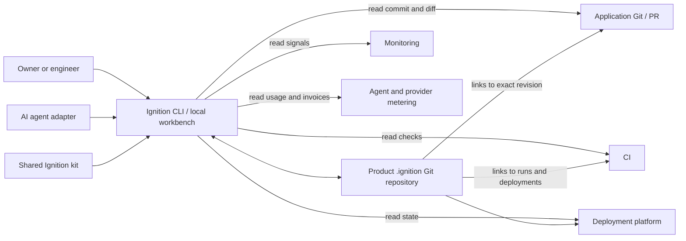

# Ignition product design

**Status:** Proposed for owner review
**Scope:** Product-independent engineering workspace
**Version:** Design draft 0.1, 27 October 2026

## Product promise

Ignition helps a product owner and engineering agents answer: What are we building? Why this design? Who or what did the work? What changed and what did it cost? What evidence shows it works? What is running and how do we recover?

It should make disciplined engineering easier to follow, without becoming a second application codebase or another place to paste every conversation. A record is useful only when it points to a real decision, revision, observation, or owner.

## Boundaries

- The shared Ignition repository contains the workflow and templates; schemas and validators are planned for the first usable version.
- Each product has a separate, private `.ignition/` Git checkout for its work items, decisions, analysis, evidence, releases, incidents, and agent context. The application Git repository ignores it.
- Application code, tests, migrations, and runtime configuration stay in the application repository. Git/PRs, CI, deployment platforms, and monitoring retain their own authoritative events. Ignition stores links and durable conclusions, not copies of every log.
- Secrets and raw personal or production data never enter `.ignition/`. Restricted evidence is referenced through an access-controlled store with a retention rule.

Ignition will not initially replace a tracker, CI service, deployment platform, observability system, or code editor. It will not infer that a passing unit test proves a production journey or deploy on an agent's assertion.

## Record model

The proposed format follows the purpose of each file. Human narratives such as work items, decisions, run handoffs, evidence, releases, and incidents are Markdown; records that need indexing have a small YAML frontmatter block. Machine-only project configuration, audit events, and usage/cost observations are standalone YAML files. General notes and `AGENTS.md` can be plain Markdown. [FORMAT.md](FORMAT.md) defines the layout, examples, and validation rules. Each structured record still has a stable ID, type, provenance, links, and a versioned schema.

Records are grouped by their primary owner: an initiative contains its child work; a work folder contains its design, agent runs, local evidence, and audit events; a run contains its usage observations. Releases and incidents have their own folders for evidence and decisions that belong to those events. Product-wide architecture, reusable decisions, and shared billing pools remain at the top level. Collision-resistant product-prefixed ULIDs and explicit links handle records that contribute to more than one work item without copying them.

| Type | Key relationships | Distinctive fields |
| --- | --- | --- |
| Initiative | Child work, outcome evidence, architecture | Goal, boundaries, success measure, priority, owner |
| Work item | Design, PR, evidence, release | Kind, size, risk, urgency, outcome, acceptance criteria, initial blast radius |
| Architecture model | Work items, flows, deployments, releases | Systems, runtimes, relationships, owners, data and trust boundaries |
| Design/decision | Work item, superseding decision | Options, chosen approach, reason, data/security impact |
| Evidence | Work item, commit, CI run, deployment | Claim, method, environment, fixture, time, result, limits, retention |
| Release | Work items, deployments, evidence | Accepted revision, checks, approval, rollback, observation |
| Incident | Release, monitoring, follow-up work | Impact, timeline, cause, recovery, prevention |
| Agent run | Work item, parent run, code revision, evidence | Agent and model identity, instructions revision, scope, start/end, outputs, outcome |
| Audit event | Run, work item, review or release | Actor, action, time, source, decision, affected revision |
| Usage/cost observation | Run when applicable, work item, release, provider source | Units, currency, amount if known, estimate/bill status, attribution, reconciliation |

Review comments stay in the PR. A consequential review outcome is recorded as an audit event under the relevant work or release; an accepted architectural decision gets a decision note. This avoids a separate, undefined review-outcome record type.

The application commit SHA, image digest or deployment ID, environment, time, and method are required before a result can be displayed as **Verified**. A proposal, an agent inference, a test failure, and an untested claim have visibly different states. Corrections and superseding decisions remain traceable in Git history.

## Product architecture and blast radius

Ignition models systems, runtime parts, source repositories, deployment units, data stores, relationships, and important user journeys separately. A repository can contain web and worker applications; a product can span several repositories. [ARCHITECTURE_MODEL.md](ARCHITECTURE_MODEL.md) defines the versioned architecture graph and its links to work, tests, releases, incidents, and costs. C4 context, container, deployment, and selective dynamic views make the graph understandable; they are views of the model, not an independent source of truth.

## Classification and routing

Ignition asks for four independent attributes. It may suggest values from the request and repository context, but a person confirms them before work is marked Ready.

| Attribute | Choices | What it changes |
| --- | --- | --- |
| **Kind** | Initiative, feature, bug, task, investigation, incident | Which questions and record template appear |
| **Size** | Small, medium, large | Whether the work should be split; it never removes a safety check |
| **Risk** | Low, normal, high | Design, security/data review, test, staging, and release gates |
| **Urgency** | Normal, expedited | Order and timing; expedited work records deferred checks and follow-up |

The kinds route differently:

- **Initiative:** outcome, boundaries, existing capability inventory, success measure, and child slices. It does not go straight to a code PR. “Build an ATS” starts here.
- **Feature:** new observable behavior, user journey, acceptance and failure criteria, then a normal PR and release path.
- **Bug:** expected versus actual behavior, reproduction, impact, regression test, and verification that the failure is gone.
- **Task:** bounded operational, documentation, refactoring, or infrastructure work with an explicit done condition and affected-system check.
- **Investigation:** a time-boxed question, method, findings, and decision. Production changes require a follow-up feature, bug, or task.
- **Incident:** impact and containment first, timeline and recovery evidence, then linked corrective work. A hotfix is an expedited bug or task linked to the incident, not an excuse to erase skipped checks.

Risk is assessed separately from size and kind. A one-line authorization bug can be **small and high risk**; a large documentation reorganization can be **large and low risk**. High-risk work gets design and release review even when the code diff is tiny. Low-risk work still needs a clear outcome, relevant check, and review. Ignition shows only the fields and gates relevant to that combination.

## Agent work, audit, and cost

Agent activity is part of the engineering record, not an invisible side channel. [AGENT_GOVERNANCE.md](AGENT_GOVERNANCE.md) defines a run, consequential events, cost attribution, and governance rules. A run links its task, product, agent/provider identity, parent run when delegated, instruction and policy revisions, allowed scope, start and finish, application revisions, PRs, tests, decisions, and outcome. The run record summarizes the work; it does not copy the full chat or private reasoning.

The audit trail records consequential actions and decisions: delegation, changes of scope, PR submission, review outcome, test evidence, gate exception, approval, deployment, and rollback. Each event has an actor, time, source, and affected revision. Agent self-reports are marked as claims until corroborated by Git, CI, deployment, or a human decision. Protected Git history and links to the original systems make corrections and later review possible.

Usage and cost observations link to runs when applicable, or directly to work, release, or a shared pool. They can cover agent providers, CI, staging infrastructure, and other development services; human review time is optional and self-reported. Each observation names its metering source, unit, quantity, currency and amount when available, attribution rule, and whether the amount is measured, estimated, reconciled, or unknown. The observation owns its allocation shares, which total 10,000 basis points across work items and an explicit **Unallocated** target. Ignition can then roll up cost by work item, initiative, product, release, provider, or period without pretending that every provider session has a billable per-run price. Budgets and alerts guide work; spending or completing a run does not waive engineering gates.

## Experience

Ignition starts as a local command-line tool with readable Markdown records. A local workbench can follow once real use confirms the record model. The workbench reads the same Git files; it has no hidden source-of-truth database.

```text
┌──────────────────────────────────────────────────────────────────────────────┐
│ IGNITION   Example App ▾    App: abc1234   Records: def5678   Sync: current  │
├───────────────┬───────────────────────────────────────┬──────────────────────┤
│ Work queue    │ WORK-42  Bug · Small · High risk      │ Evidence & risk      │
│ Decisions     │ Outcome · Criteria · Design           │ ✓ Local tests        │
│ Releases      │ Change · Review · Stage · Production  │ ✓ Staging journey    │
│ Incidents     │ [current stage: In review]            │ ? Production         │
│ Search        │                                       │ Blast radius         │
│               │ Withdrawn CV access · review timeline │ Data · permissions   │
└───────────────┴───────────────────────────────────────┴──────────────────────┘
```

The project home shows the current production revision, open work, blocked gates, recent releases and incidents, agent activity, attributed and unallocated cost, and one or two operational signals. A work-item view follows the lifecycle from outcome to observation and links the agent runs that contributed. An evidence card always displays the exact scope and source. A release view compares intended and running revisions, shows the real journey checks and rollback route, and makes missing evidence obvious. Green is reserved for verified observations; unknown stays visibly unknown.

The first release is usable without the visual workbench. People and agents can inspect records through Git and the CLI. A future UI should improve navigation and capture, not create a parallel data store.

## Architecture



Adapters are optional and permission scoped. The core works from local Git and manually entered links. An adapter may fetch PR, CI, deployment, or monitoring metadata and propose an evidence update; a person or configured policy decides whether it is accepted. Credentials remain in the OS credential store or provider auth flow, never in records. In the first version adapters are read-only.

In the proposed version, agent integration reads `.ignition/project.yaml`, `.ignition/PROJECT.md`, `.ignition/AGENTS.md`, and the active work item. The v0.4 attach script does not create `project.yaml`. An agent can suggest or write records to the Ignition checkout and make application changes through normal Git/PR review. It records a run ID at start and a linked outcome at handoff. A completed agent run is not proof: checks and human/release decisions remain separate. Provider usage and billing adapters are read-only; they must preserve source references and uncertainty.

## First usable version

1. Attach an independent `.ignition/` checkout without changing application Git status. The basic script exists; linked-worktree and failure-path hardening is in [PR #2](https://github.com/mohsalsaleem/ignition-engineering/pull/2).
2. Add schemas and validation for Project, Architecture, Initiative, Work item, Decision, Evidence, Release, Incident, Agent run, Audit event, and Usage/cost records. Keep their Markdown readable without the tool.
3. Add commands to mint collision-resistant IDs, create records, start and close an agent run, link application revisions/PRs, list work by state, report missing evidence and affected architecture elements, and show attributed versus unallocated usage. Do not run arbitrary project commands from record content.
4. Add bounded read-only GitHub and deployment adapters, then a provider usage adapter. Manual links and explicit **Unknown** cost remain supported.
5. Pilot one real Talintr change with a small architecture inventory, run attribution, evidence, cost capture, and a release/incident review before building the local workbench.

The first version is successful when a new collaborator can reconstruct one change from its work item through agent sessions, review, production verification, and cost provenance using the links and evidence, while the application repository's status and deployments remain unaffected by Ignition-only edits.

## Later, if the pilot proves the need

- A local workbench for navigation, review, evidence capture, and release readiness.
- Search across products and reusable checklists, without merging their private records.
- Optional hosted synchronization and team permissions; Git remains the exportable record format.

## Decisions still needed

- Which issue tracker is canonical for each product? Work folders may hold engineering dossiers with either choice, but tracker-owned priority and status must not be duplicated.
- Which evidence needs long-term preservation, and where are restricted artifacts stored?
- Which integrations may write, and which production actions always require a named release owner?
- Which agent providers expose session-level usage, and how should subscription or shared costs be allocated when they do not?
- Which run details can each role see, and what retention or immutable audit export does each product require?
- Which platform should host the first local workbench, if a CLI and Markdown are insufficient after the pilot?
