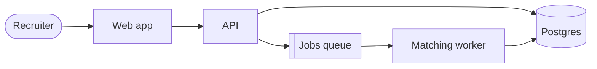
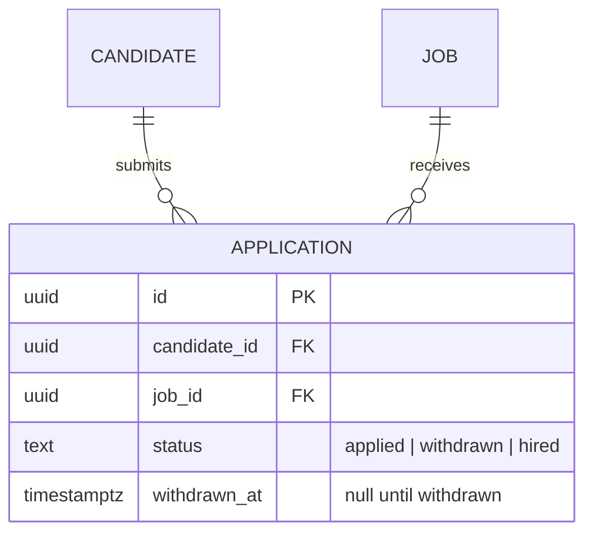
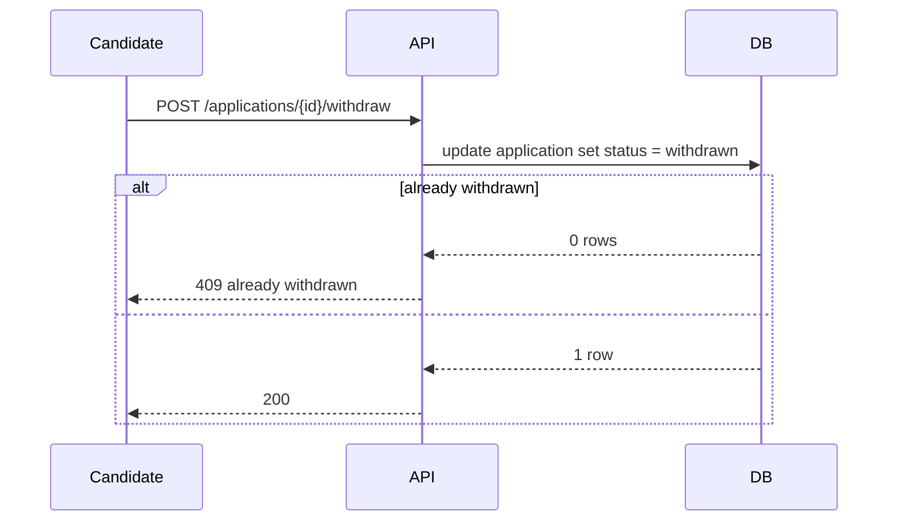

# Architecture docs and diagrams

## The architecture docs

`.ignition/architecture/` describes the system as it is now. Designs read it
first and describe their change against it. The work that changes the system
updates it, in the same branch as the change.

| File | Holds | Updated |
| --- | --- | --- |
| `overview.md` | Context, containers (apps, services, workers, stores, queues), trust boundaries | When a design adds, removes or reconnects a container |
| `data-model.md` | The agreed data model: an `erDiagram`, then each table's purpose, owner, personal data, retention and invariants | **In the design stage**, by any design whose Data model section describes a change |
| `flows/<journey>.md` | One important journey: a `sequenceDiagram`, its failure paths, what must always hold | When a design changes that journey |

**The data model is agreed before it's built.** A design that changes the
data writes the target model into `data-model.md`, naming its work item next
to what it changed. The owner then approves the model with the design, and
`ignition advance` won't leave design until the file names the item. Build
implements it in migrations or ORM models, which stay the source of truth for
exact types. If the build has to differ from what was agreed, update
`data-model.md` and the design. If that changes what the owner approved, log
`--type scope` and ask.

`init` creates these files, and entering design creates any that are
missing. If they're empty when you need them, fill in what your design
touches from the code. Don't try to document the whole system at once.

## Diagrams

Use Mermaid in a fenced `mermaid` block. It's plain text, so it diffs and
reviews like code. GitHub renders it for people, and agents read it directly.

- One diagram per idea: one flow, or one bounded group of tables. Split a
  diagram that needs scrolling.
- Use the names the code uses for services, tables and endpoints.
- A diagram shows structure and order. State the rules (uniqueness,
  idempotency, who may do what) in the text under it.
- In a design, draw only what changes, plus enough context to place it.
- Diagrams are recommended, not checked. Where a section asks for one and it
  wouldn't help, write the text alone.

### Containers: `flowchart`

`([ ])` is a person, `[( )]` a data store, `[[ ]]` a queue. Label an arrow
with the protocol or event when it matters: `api -- "job.created" --> queue`.

### Data model: `erDiagram`

Under it, for each table: indexes and unique constraints, personal data,
retention, invariants. In a design, add the migration: how old and new code
run side by side, the backfill, and the rollback.

### Flows: `sequenceDiagram`

Include at least one failure path with `alt` or `opt`. Under the diagram, say
what is retried, what is idempotent, and which step commits the change. The
QA agent tests every failure path you draw.

**Inside a record template's `<!-- -->` guidance, never write a diagram.**
Mermaid's `-->` arrow ends the comment early. Write diagrams as section
content.
